# Arrakis Orbit

A self-contained Eclipse background: Arrakis crescent, restrained Caladan,
a small moon, and a layered starfield.

[](svg/arrakis-orbit.svg)

Open [index.html](index.html) to compare
three formats side by side. The comparison scrolls horizontally on narrow screens.
Live iframe previews follow frame focus; click a live preview to animate it.
Each variant page contains only its background:

| Variant              | Page                                               |
|----------------------|----------------------------------------------------|
| Live WebGL           | [webgl/index.html](webgl/index.html)               |
| Native web component | [webcomponent/index.html](webcomponent/index.html) |
| SVG CSS background   | [svg/index.html](svg/index.html)                   |

## Run and build

Node.js 22 or newer is supported. Install pinned dependencies:

```shell
npm ci
```

Start the server and open its printed URL. `PORT` overrides the default 4174:

```shell
npm run serve
```

Check committed artifacts against their recorded source hashes:

```shell
npm run check:generated
```

Regenerate the component, page bundle, animated SVG, and still SVG:

```shell
npm run build
```

Install browser engines before the first test run:

```shell
npx playwright install chromium webkit
```

Run every automated check:

```shell
npm test
```

Each variant folder is a complete runtime distribution. Copy `webgl`,
`webcomponent`, or `svg` alone, serve that folder over HTTP, and open its
`index.html`. No parent files, build tools, or package installation are required.
Direct `file:` loading does not support browser modules reliably.

The full project is only needed for editing and rebuilding. Canonical renderer,
styles, and [artwork](src/assets/CREDITS.txt) live in [src](src); generators and the
server live in [scripts](scripts). The [build manifest](build-manifest.json)
records build inputs and outputs for freshness checks.
Builds copy required assets into each live variant and bundle its styles and fallback.

## Embed

Copy the [webcomponent directory](webcomponent/index.html), keeping
[arrakis-orbit.js](webcomponent/arrakis-orbit.js) beside its
[assets directory](webcomponent/assets/CREDITS.txt). From that copied directory:

```html

<script type="module" src="./arrakis-orbit.js"></script>
<arrakis-orbit style="width:100%;height:480px" aria-hidden="true"></arrakis-orbit>
```

Each element fills its explicitly sized host. It owns its Shadow DOM, WebGL
resources, observer, and listeners. Removal releases resources; reinsertion creates
a fresh renderer. Multiple instances have independent sizes, styles, and pause state.

The `paused` attribute or Boolean property stops one instance. Pause is not persisted.
Reduced motion overrides animation. The optional `scene` attribute accepts
`conjunction`, `eclipse` (default), or `deep-field`; it is read on connection.
The plain WebGL page exposes `window.orbit.setPaused(boolean)` and `dispose()`.

## Rendering

WebGL uses the original textured sphere shaders. Focus changes ease over
650 milliseconds. Hidden pages and page suspension stop immediately. Drawing is
capped at 30 fps, two device pixels per CSS pixel, a viewport pixel budget, and GPU
limits. Missing textures, unavailable WebGL, or context loss show a CSS orbital
fallback. Context restoration recreates the live scene.

The SVG bakes sphere lighting from the same local maps and embeds its images.
Drift and star twinkle approximate motion; sphere rotation, moving clouds, shader
atmosphere halos, procedural nebulae, and focus easing remain specific to WebGL.
The SVG starfield is sparser. Eclipse is the only SVG composition.

The [animated SVG](svg/arrakis-orbit.svg) always animates. CSS SVG images do not
consistently receive the host page's reduced-motion preference.
The [SVG page](svg/index.html) therefore switches to
[still SVG](svg/arrakis-orbit-still.svg) through a host-page media
query. Keep that query when embedding the animated CSS background.

## Attribution and tests

[Asset credits](src/assets/CREDITS.txt) retain licenses, source URLs, and adaptation details.
The [texture utility](scripts/prepare_textures.py) recreates the JPEG maps with Pillow
from local `mars.jpg`, `clouds.jpg`, and `moon.jpg` source maps. Pass `--source-dir`
and a new `--output-dir`; add `--download` to fetch missing sources. Normal builds
use the checked-in maps without network or Python dependencies.

Tests cover the three real variant pages in Chromium and WebKit at four viewport
sizes, the side-by-side comparison, and actual pixel evidence for every landmark.
They also copy each variant alone into an isolated HTTP root and verify that all
artwork loads without external requests or missing files.
Negative controls remove individual planets or the starfield. The adapted upstream
suite retains focus, visibility, motion, resizing, loading, and failure checks.
Component tests cover isolation, reconnection, and resource cleanup. SVG tests
cover animation, reduced motion, self-containment, and generated-artifact freshness.
Screenshots are retained in `test-results`.

Physical devices, GPU drivers, and production hosting require separate verification.
